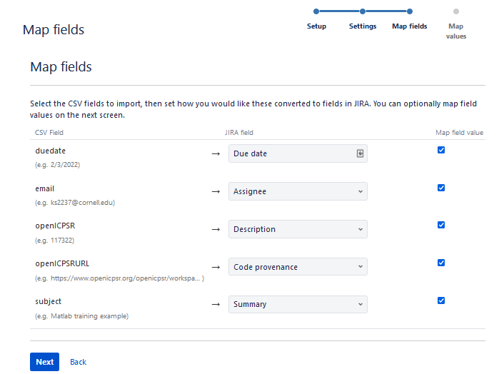

# Setup of Hiring and Training

### Hiring

#### Timelines:

  - Fall: Post mid-July and train mid to late August
  - Spring: Post mid-November and train mid January
  - Summer: Post mid-March and train late April

**Note**: In the [Replication Project Resumes](https://docs.google.com/spreadsheets/d/1Ic4UgBR3gNFvgyFigJ5SAnx0rZwlp9vu_9OV39YoXQQ/edit?pli=1#gid=991404332) Live sheet, the names highlighted in yellow are people we may or definitely will want to rehire (some leave for the summer or something). Double check with Lars if we want to reach out to them for re-hire.

#### Post the job:

1. Hiring Google Form is [here](https://forms.gle/QoZdqeLab4dwB25Q7). Update the form so that the responses go to a new sheet in the "Replication Project Resumes" file.
2. Email ILR Student Employment (ilr_student_empl@cornell.edu) to copy exising RA Workday posting with adjusted wages
3. Update the job posting on the [LDI website](https://www.ilr.cornell.edu/labor-dynamics-institute)
   - Contact Sara Brooks (seb349@cornell.edu) to make edits to website. Tell her the edits to make:

<blockquote>

- Starting wage is $[Level II wage] per hour
- Training will take place on [Date] in person
- How to Apply: 
  - Log in to Workday via http://studentemployment.cornell.edu/jobs/student-job-and-intern-service and search for job listing WDR-[UPDATED NUMBER]. (The text can be seen without logging in, but you must be logged in to apply.)
  - [UPDATED WORKDAY LINK]
  - Additionally, you must complete the form here, https://forms.gle/xtXTCdDgTsnZRvuD6, to be considered.
</blockquote>

   - Copy from previous posting, adjust title and ensure URL reads correctly
   - Link to Workday posting and to Google Form may need to be added (see below why they do not carry over)

#### Disseminate availability of position:

- Econ: Brook Musmacker (Economics Undergraduate Experience Coordinator, economics-uec@cornell.edu) and ask that she include it in the next Ezranomics newsletter as well as any faster dissemination. The job is already featured on the [research opportunities](https://economics.cornell.edu/undergraduate-student-experiences#research-opportunities) page - verify that it is still accurate
- Brooks School (aka PAM) (brooksstudentbulletin@cornell.edu) This email goes to students directly
- Dyson: Gretchen C. Gilbert (Registrar and Student Support Specialist) gcg4@cornell.edu
- Statistics: (ugrad@stat.cornell.edu)  This email goes to students directly
- CIS: Julia Aquadro (Assistant Director of Undergraduate Advising) jra269@cornell.edu

- If the person you emailed no longer works for that department, google their former title and find the new person in that position

Email template to staff:

> Subject: LDI is Hiring Undergraduates for [Semester] 2024

​<blockquote>​
Hello,

We are looking to spread the word about our hiring of RAs this coming [semester]. Could you please share this with your students? Thank you so much

The Labor Dynamics Institute is looking for 10 RAs to hire for [semester] 2024

To learn more: https://www.ilr.cornell.edu/labor-dynamics-institute/ldi-news/join-ldis-replication-lab

To apply:

Apply via Workday: Job Requisition ID WDR-0000000

And fill out the required google form: https://forms.gle/fP24wBvJ8VLdgkZX6

</blockquote>

Email template to student listserv:

> Subject: LDI is Hiring Undergraduates for [Semester] 2024

​<blockquote>​

The Labor Dynamics Institute is looking for 10 RAs to hire for [semester] 2024

To learn more: https://www.ilr.cornell.edu/labor-dynamics-institute/ldi-news/join-ldis-replication-lab

To apply:

Apply via Workday: Job Requisition ID WDR-0000000

And fill out the required google form: https://forms.gle/fP24wBvJ8VLdgkZX6

</blockquote>

#### Review

Lars, the Research Aide, and Graduate Assistant then review applicants and then meet to discuss final decisions. Once final decisions are made, the following steps are taken to prepare for training the new cohort of Undergraduate Research Assistants.

1. Send out rejection email. bcc all candidates who were not selected with the following (make sure to update the next upcoming application cycle):

---
Dear Applicant,

Thank you for your application to the LDI Replication Lab. We received a lot of applications from talented folks like you. Unfortunately, you were not selected at this time. 

However, our project will be hiring again in the Summer, and we invite you to consult our job posting at that time. We will be posting any updates on the LDI home page at http://www.ilr.cornell.edu/labor-dynamics-institute. 

Although we cannot provide detailed feedback on your application, one of the frequent reasons that students like you are not selected is that we explicitly search for experience with desktop-style statistical programming languages, in particular with Stata or Matlab. If you have not used these before, but are interested in brushing up your skillset, CCSS Research Computing offers free training to Cornell students in all of these. Regardless if you intend to re-apply in the Summer or for your own self-improvement for the job market, we strongly suggest taking one of these. 

Again, thank you for your interest, and please stay in contact.

---
2. Send out hire notification to selected applicants:

`Subject: [RESPONSE REQUIRED] You've Been Selected for LDI's Replication Project`

---
All,

Thank you for applying to the AEA Replication Project. 

We have reviewed your application, and have identified you as a qualified candidate. We would like have you join us for the training, during which we will present the task at hand, train you in using the tools and procedures you will need, and walk you through an actual replication task. 

**Training will take place in-person on Wednesday January 17th**, and virtually January 18-23rd. Live attendance should be expected on Wednesday and additional meetings will happen on the following days using Zoom, plus some significant self-paced work. Schedule found [here](https://labordynamicsinstitute.github.io/replicability-training/).

We must note that this is not a confirmation of employment. During the training, HR will be checking your eligibility for employment, which includes being a current Cornell student and residing in the United States; an [I-9](https://www.uscis.gov/i-9-central/form-i-9-acceptable-documents) may be needed.

**Please let us know if you are still interested in the position.**

Thank you,

---

#### Close position

- Close Workday posting
- Stop accepting submissions on Google Form
- Accept new RAs on Workday
- Leave LDI page up, but remove link to Google Form

### Training schedule

3. Lars, Research Aide, and GRA meet and discuss a training schedule. Research Aide then drafts a schedule for Lars to review and update the [github page](https://github.com/labordynamicsinstitute/replicability-training) for the [website](https://labordynamicsinstitute.github.io/replicability-training/). 
4. Track which students accept the training invitation in the "Replication Project Resumes" spreadsheet.
5. Once training schedule is set and new RA's have accepted the invitation to the Lab, send out invites (LDI Zoom links) to Day 1 of the training and the following peer review sessions. 

### Training Preparation

1. Add new trainees to the Bitbucket `aeaverification` team as "Developers" [here](https://bitbucket.org/account/user/aeaverification/groups/developers/) by pasting their email into the search bar under "Add member", and clicking "Confirm".
2. Pre-approver link: https://aeadataeditors.atlassian.net/plugins/servlet/project-config/AEAREP/people
3. Add users to Jira
  - log on to Jira as "dataeditor@aeapubs.org"
  - Click on [People](https://aeadataeditors.atlassian.net/jira/people/search). 
  - Click on Manage users
  - Invite users.
    - Email addresses: comma separated (it used to be limited to 10 at a time, but they're updating this)
    - Product roles is defaulted to `User`
    - Group membership: `trainees`, `replicators`, and `jira-software-users`
    - Click "Invite users"
3. Bulk import test cases to Jira:
  - First, modify the existing [CSV file](https://github.com/AEADataEditor/LDI-Research-Aide/tree/main/Training) with the new "email" and "duedate" fields.
  - Remember to create one for Lars for the first Stata case, and one for each of the experienced RAs who are conducting the peer review sessions.
  - Go to the brown/red "Create" button in Jira, then select "Import issues".
  - Choose the corresponding CSV file and check the "Use an existing configuration file" box to use the [mapping file](https://github.com/AEADataEditor/LDI-Research-Aide/blob/main/Training/jira-import-mapping.txt)
  - Settings: Import to "AEA training" project, file encoding = UTF-8, delimiter = ",", Date format = "MM/dd/yyyy"
  - Mapping:

  - Start import, then "check issues"

4. The bulk importer does not map the openICPSR number field, nor allow for a link to the manuscript. From the "..." at the top right corner, choose "bulk change all x issue(s)", select all issues, and select "Transition Issues"
5. bulk "transition" them from "Open" to "Assigned". You should then be presented the "Bulk Edit Screen" (if not you can just repeat these steps to get to the "Edit Issues" option of the bulk action screen). Then edit these fields
    - "openICPSR Project Number"
    - "Manuscript Central identifier" (i.e. AER-0000-1234)
    -  'Comment" Add link to proper PDF of manuscript ([PDF_Proofs](https://labordynamicsinstitute.github.io/replicability-training-solutions/)).
8. Grant RA's access to download ICPSR deposit (students will need to create their accounts with ICPSR first).
10. Create "Placeholder" tickets for each RA in Jira. The best way to do this is through the same bulk process as creating the training cases (a placeholder csv file can be found [here](https://github.com/AEADataEditor/LDI-Research-Aide/tree/main/Training)). Be sure to change the "Import to Project" field from "AEA Training" to "AEA Replication - Default". Then convert each issue to a subtask for the Master Placeholder aearep-1407 (unsure if there is a way to bulk convert to subtask).
11. Add students to [listserv](https://www.list.cornell.edu).
12. Go to "/Box/Office of AEA Data Editor/Student Employment/Current_Hire-Exit_Checklists" and create a new exit checklist file for each student. This way we can track what has been done when exiting a student in the future.

5. After training, grade reports using https://github.com/labordynamicsinstitute/replicability-training-solutions as a reference

### Edit Replication Resumes

- Copy the new RAs into the Live sheet.
- Update the columns for *"Start Date"* (column AB) and *"WD End Date (last updated mm/dd/yy)"*

## Exit Checklist

### Graduated Students

[ ] Remove from LDI-Lab mailing list.
[ ] In Jira, transition the “Placeholder” ticket to “Done.”
[ ] Remove from Jira (log in as “dataeditor@aeapubs.org” > People > Manage Users > Total Users > Click on the RA > “Remove user”).
[ ] Remove from Bitbucket (aeaverification workspace > Workspace settings > [Users on plan](https://bitbucket.org/aeaverification/workspace/settings/user-directory) > Then remove access).
[ ] Remove from calendar invites (Monday and Thursday meetings).
[ ] Update Replication Project Resumes sheet.
[ ] Request removal of admin access from OpenICPSR (for submitters only).
[ ] Lars remove LastPass share of ScholarOne password (for submitters only).

### Mid-Year Departure

[ ] Lars to send email notifying the RA of termination.
[ ] Remove from LDI-Lab mailing list.
[ ] In Jira, transition the “Placeholder” ticket to “Done.”
[ ] Remove from Jira (log in as “dataeditor@aeapubs.org” > People > Manage Users > Total Users > Click on the RA > “Remove user”).
[ ] Remove from Bitbucket (aeaverification workspace > Workspace settings > Users on plan > Then remove access).
[ ] Remove from calendar invites (Monday and Thursday meetings).
[ ] Update Replication Project Resumes sheet.
[ ] Email ilr_student_empl@cornell.edu (cc Lars) to inform HR that the student is being terminated.
[ ] Email ciser@cornell.edu to request that their account be disabled.
[ ] Request removal of admin access from OpenICPSR (for submitters only).
[ ] Lars remove LastPass share of ScholarOne password (for submitters only).

Email template:

---
Dear [RA],

I have come to the unfortunate conclusion that your  availability and the needs of the LDI Replication Lab are not well aligned. As of immediately, I am ending your relationship with the LDI Project.

[Ilanith] will be processing the exit procedures.

I thank you for your efforts, and wish you well in your future endeavors.

Sincerely,

Lars

---