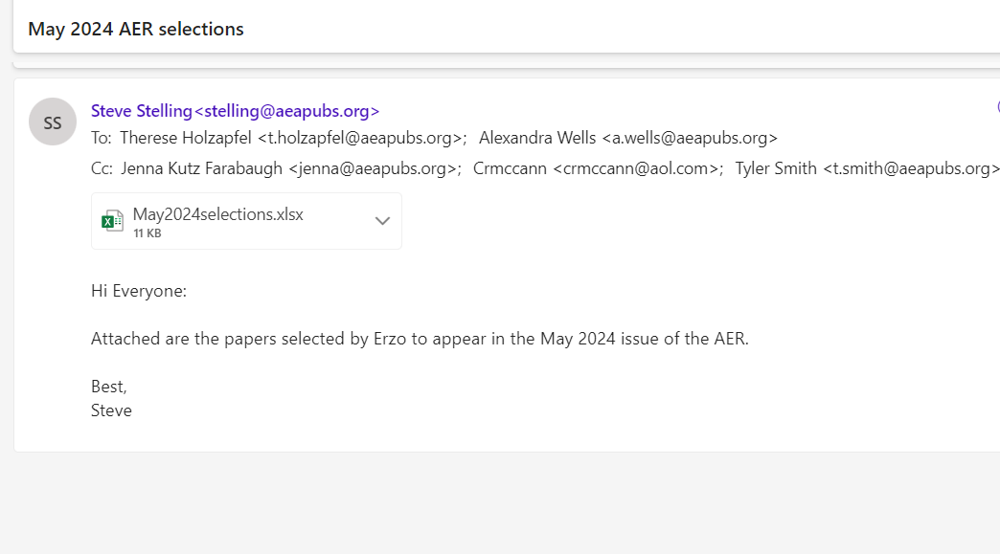
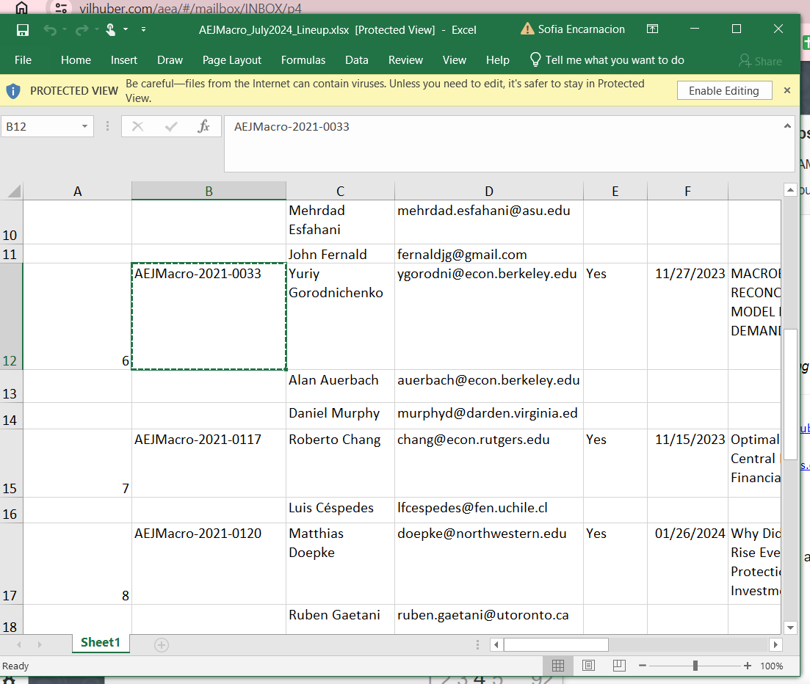
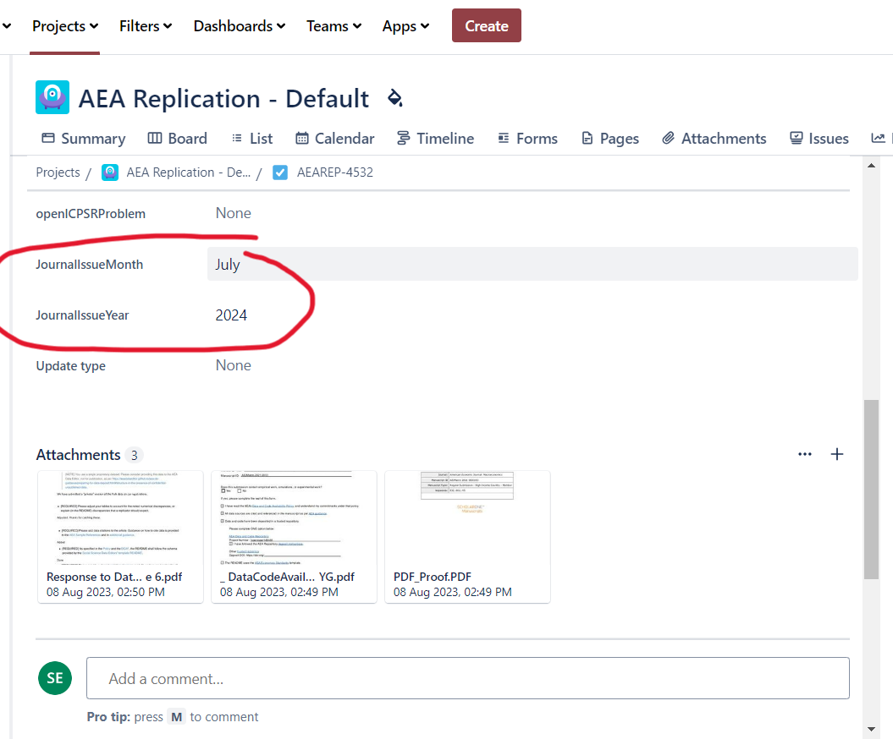

# Daily and Weekly Tasks

## Daily Checks

1. Check Jira if RAs need new cases. They should have at least two main Jira tasks in their queue. Refer to the [Master Replication Project](https://docs.google.com/spreadsheets/d/1Ic4UgBR3gNFvgyFigJ5SAnx0rZwlp9vu_9OV39YoXQQ/edit?pli=1#gid=1902712667) Sheet for skill levels of programs for each RA.
2. Check the Data Editor email (dataeditor@aeapubs.org). More details below.
3. Check unassigned tasks and fill in Jira tickets.

###  2 Checking the Data Editor email

Besides responding to authors, there are a few standard emails that you'll recieve that require action.

#### (a) Lineup

Occassionally we get emails from the AEA offices about the line-up of upcoming paper. They're usually titled something like "[Journal] [Month] Lineup".

Example:

1. Open the attached xlsx file.
2. Search the Manuscript Central number on Jira

3. Go to the most recent Jira Task ticket associated with the manuscript.

4. Go to the "Other Links" tab of the ticket and scroll down to *Journal Month* and *Journal Year* and update the fields based on the Excel title.

#### (b) Submitted on openICPSR

1. Search the word "Submitted" in the email
2. Click on the emails titled "Your AEA Data and Code Repository Project openICPSR-204201V1: Submitted"
3. Click the openICPSR deposit linked in the email.
4. In the openICPSR deposit, scroll down to the Communication Log
5. Check if the case is a revision. If so, update the Jira ticket from "Pending openICPSR Changes" to "Assess openICPSR Changes".

## 3 Check Unassigned Cases

### Basic Instructions

1. Go the unassigned filter in Jira.
2. In the most recent cases, fill out the following info from the DCAF attached:
    - `DCAF_Access_Restrictions`
        - (if "Yes, data can be made available privately", do additional steps below)
    - `DCAF_README_checked`
    - `openICPSR Project Number` 
    - `Software Used` (from openICPSR deposit)

2. When checking the software in the openICPSR deposit, open the README and make sure it exists. If there is no README in the openICPSR deposit, make a short report.
3.  Check if the case is a Revision by looking at the MCStatus and/or by going to the *Other Links* tab and clicking the `JiraSearchMC`. If this case is a Revision:
    - Link Revision: Go back to the main Tasks you were editing, click "Link Revision" > "Is a Revision of" and then input the AEAREP number of the older task.
    - Update `MCStatus` to include 'Revision' if it doesn't already have it.
    - (optional, but helpful) Update the `bitbucket short name` with the repository name of the previous cases.
4. Check that there is a manuscript attached

### Additional Steps for Restricted Access Data

1. Check if the case is a Revision. If yes, check that we haven't already asked for the Restricted Access Data. If yes, link the existing subtask to the most recent revision. If no, move on to next steps.

2. Create subtask with type "Request Confidential Data". Title the subtask "Request Restricted Access Data for AEAREP-xxx" and assign it to yourself.

3. Continue steps listed in [Requesting Restricted Access](https://github.com/AEADataEditor/LDI-Research-Aide/blob/main/Requesting_Restricted_Access_Data.md#requesting-restricted-access-data-from-authors)

### If no manuscript

1. Go to "Other Links" and click on the MCEntryURL.
2. After logging in, click "Review". Ctrl+F and search for the Manuscript Number.
3. Once you find the manuscript, go to the Action section, "View Proof", download the PDF of the manuscript.
4. Attach the PDF to the Jira ticket.
